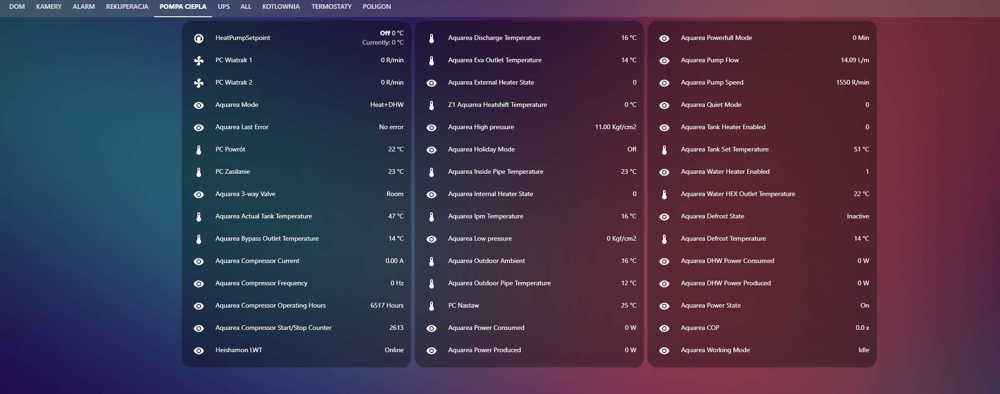

# CZ-TAW1/CZ-TAW1B

This project is to modify Panasonic CZ-TAW1 Firmware to send data from heat pump to MQTT instead to
Aquarea Cloud (there is some POC work proving there is a posiblity to send data concurently to
Aquarea Cloud and MQTT host using only modified CZ-TAW1 ,but it's not yet implemented in this
project )

## Active forks

The last release here is 1.0.194 (2023-10). Work continues in these forks (as of October 2026):

- [pando85/GoHeishaMon](https://github.com/pando85/GoHeishaMon) continues the GoHeishaMon app
  with the same `SetXxx` command topics, so e.g. the
  [NodeRed_Heishamon_control](https://github.com/edterbak/NodeRed_Heishamon_control) dashboard
  keeps working. Its latest release is 1.2.0 (2025-11), which rewrote the serial communication,
  and it runs on the firmware from this repo. Its main branch also has fixes that aren't released yet:
  - data races (1.2.0 crashed with memory corruption after a few days);
  - recovering the link when the USB serial adapter drops out.
- [rondoval/GoHeishaMon](https://github.com/rondoval/GoHeishaMon) is a rewritten app with a
  different topic scheme (`.../Heatpump_State/set` instead of `SetHeatpump`).
  [rondoval/openwrt](https://github.com/rondoval/openwrt) (branches `panasonic-cz-taw1-*`) is
  a full OpenWrt port for the CZ-TAW1, up to OpenWrt 24.10 with kernel 6.6. It replaces the two
  Panasonic firmware sides with one partition.
- [piomar123/GoHeishaMon](https://github.com/piomar123/GoHeishaMon) has this firmware with the app
  binary in the overlay, so it can be replaced without reflashing. It adds a procd service with
  respawn and crash logs, LEDs that show heat-pump traffic, and docs for updating the binary in the
  small JFFS2 overlay. It runs the pando85 app. There are no prebuilt images; its README lists the branches.

Choosing between this firmware and rondoval's OpenWrt port:

| | This firmware (or piomar123's variant) + pando85 app | rondoval's OpenWrt port |
|---|---|---|
| Install | USB stick, button combination | serial console + TFTP, then sysupgrade |
| Original Panasonic firmware | kept on the other side, switchable back | gone (restore only from your own flash backups) |
| System | OpenWrt from ~2014, kernel 3.14 | OpenWrt 24.10, kernel 6.6, LuCI over HTTPS |
| Free flash for the app | ~2 MB overlay (binary must stay under ~1.8 MB) | ~5.5 MB |
| Risk | low | can brick the device without a serial console |

rondoval's image can also be booted from RAM over TFTP (`bootm 0x81000000`) without writing the
flash, which is a safe way to try it first.

## This Project Contains

- Main software (called GoHeishaMon) responsible for parsing data from Heat Pump - it's golang
  implementation of project https://github.com/Egyras/HeishaMon All MQTT topics are compatible with
  HeishaMon project: https://github.com/Egyras/HeishaMon/blob/master/MQTT-Topics.md and there are
  two aditional topics to run command's in system runing the software but it need's another manual.

GoHeishaMon can be used without the CZ-TAW1 module on every platform supported by golang
(RaspberyPi, Windows, Linux, OpenWrt routers for example) after connecting it to Heat Pump over
rs232-ttl interface. If you need help with this project you can try Slack of Heishamon project there
is some people who manage this one :)

- OpenWRT Image with preinstalled GoHeishaMon (and removed A2Wmain due to copyright issues)

CZ-TAW1 flash memory is divided for two parts called "sides". During Smart Cloud update A2Wmain
software programing other side then actually it boots ,and change the side just before reboot. In
this way, normally in CZ-TAW1 there are two versions of firmware: actual and previous. Updating
firmware with GoHeishaMon we use one side , and we can very easly change the side to Smart Cloud
(A2Wmain software) by pressing all three buttons on CZ-TAW1 when GoHeishaMon works ( middle LED will
change the color to RED and shortly after this it reboots to orginal SmartCloud). Unfortunatly from
Smart Cloud software changing the side without having acces to ssh console is possible only when
updating other side was take place succesfully.

Summary:

It is possible to go back to orginal software (A2Wmain with SmartCloud) very quick , without
preparing pendrive ,becouse this solution don't remove firmware with A2Wmain (is still on other
"Side" in the flash).

Even the GoHeishaMon is on other side you can't just change the site in orginal software to
GoHeishaMon without acces to console. You have to install GoHeishaMon again.

## WiFi configuration

WiFi should be configured in original firmware.

### Setting up WiFi Without WPS on CZ-TAW1

In the paper instructions that come with the CZ-TAW1, there's no mention of setting up WiFi without
WPS. However, in the PDF instructions found on the CD-ROM included with the device and various
online manuals, you'll find a procedure for configuring WiFi settings without using WPS.

1. **Using the HTML Utility**: The CD-ROM contains a small HTML utility that simplifies the process
   of configuring WiFi settings. This utility allows you to enter your WiFi SSID and password, which
   it then saves in a `settings.txt` file for you.

2. **USB Drive Preparation**: To proceed, insert a USB drive into your computer. We recommend using
   an 8GB FAT32-formatted USB drive (although your mileage may vary with other configurations).

3. **Create `settings.txt`**: In the utility, you'll specify your WiFi settings. The `settings.txt`
   file should have the following content (without the quotes, and there should be a newline after
   each key):

   ```plaintext
   SSID=YourSSIDHere
   KEY=APasswordBetterThanThis
   ```

4. **Transfer `settings.txt`**: Save the `settings.txt` file to the root directory of your USB
   drive.

5. **WiFi Configuration**: With the `settings.txt` file on the USB drive, insert it into the
   CZ-TAW1.

6. **Configure WiFi**: To configure the WiFi settings, press and hold the WPS button on the CZ-TAW1
   for 10 seconds. The device will read the `settings.txt` file and set up the WiFi accordingly.

7. **Final Steps**: Once the WiFi configuration is complete, you can remove the USB drive and
   install the transmitter wherever you prefer.

These steps allow you to set up your WiFi on the CZ-TAW1 without the need for WPS.

## Install instructions

New hardware should use 1.0.191 to avoid problems with PL23a3 drivers.
[Original link](https://github.com/lsochanowski/GoHeishaMon/issues/26#issuecomment-1374770882)

To install the software, follow these steps:

1. Format a USB drive to FAT32 and copy the following files to it:

   - `openwrt-ar71xx-generic-cus531-16M-kernel.bin`
   - `openwrt-ar71xx-generic-cus531-16M-rootfs-squashfs.bin`

2. Additionally, configure and copy the file named `GoHeishaMonConfig.new`.

3. Insert the USB drive with these files into your CZ-TAW1 device.

4. Press all three buttons simultaneously and hold them for more than 10 seconds. Wait until the
   middle LED on the CZ-TAW1 begins changing colors, cycling through green, blue, and red. You may
   also notice the LED on the USB drive blinking if it has one.

5. The update process will start, and it will take approximately 3 minutes. During this time, the
   CZ-TAW1 will reboot. After a while, you will see the middle LED light up in white.

6. Do not remove the drive from the module until the white LED turns off again. This indicates that
   the GoHeishaMon has copied the config file from the drive and rebooted the CZ-TAW1. Remove the
   drive before the white LED turns on again, as leaving the drive with the config file present will
   result in it being copied again and triggering another reboot.

## Board Functionality: Buttons and LEDs

### Buttons

- **WPS Button**: This button does not have a specific function and remains inactive.

- **Reset Button**: Pressing the reset button will restart the GoHeishaMon application.

- **Check Button**: The check button does not trigger any specific action.

- **Simultaneous Button Press**: When all buttons are pressed together, the board will switch back to its original firmware.

### LEDs

- **Top LED**: This LED, illuminated in green, indicates whether the operating system (OS) is currently running.

- **Mid LED**: The white light emitted from this LED signifies that the GoHeishaMon application is in operation.

- **Bottom LED**: When this LED is lit in green, it indicates the data pin's status, which is either low or high, for communication with the main board.

## Configuration

### SSH Connection

ssh was not working and dropbear doesn't started automatically. The cause is the first boot after
flashing: `/etc/rc.d/S09fw` runs `fwupdate uci-load`, which does `rm -rf /etc/config/*` and restores
the old (Panasonic) side's config. The image's `dropbear` and `uhttpd` configs end up hidden by
overlay whiteouts, so neither SSH nor LuCI starts. LuCI comes back after
`cp /rom/etc/config/uhttpd /etc/config/`.

The solution for SSH was to start it through MQTT messages. Topic for sending messages: `panasonic_heat_pump/commands/OSCommand` Topic for
reading output: `panasonic_heat_pump/commands/OSCommand/out`

Just send a `/usr/sbin/dropbear`. Example:

```bash
mosquitto_pub -t "panasonic_heat_pump/commands/OSCommand" -m "/usr/sbin/dropbear" -h <MQTT BROKER IP>
```

For connecting to ssh weaker algorithms are needed:

```bash
ssh -oHostkeyAlgorithms=+ssh-rsa -oKexAlgorithms=+diffie-hellman-group1-sha1 root@${PANASONIC_IP}
```

### Changing hostname

`/etc/config/system`

```bash
uci set system.@system[0].hostname='cz-taw1b'
uci commit system
/etc/init.d/system reload
```

### Fix dropbear

```bash
root@cz-taw1b:~# cat /etc/config/dropbear
config dropbear
    option PasswordAuth 'on'
    option RootPasswordAuth 'on'
    option Port            '22'
#    option BannerFile    '/etc/banner'
```

Set `~/.ssh/config`:

```conf
Host cz-taw1b
    User root
    PubkeyAcceptedKeyTypes +ssh-rsa
    HostkeyAlgorithms +ssh-rsa
    KexAlgorithms +diffie-hellman-group1-sha1
```

Add rsa key to `/etc/dropbear/authorized_keys` or use LuCi web UI.

### Configure NTP

Change NTP servers to your preferred ones.

Screenshot from Homeassistant: 

## TODO

- queue command from a2wmain
- flag to point to config file
- manuals
- tests

..... more....
